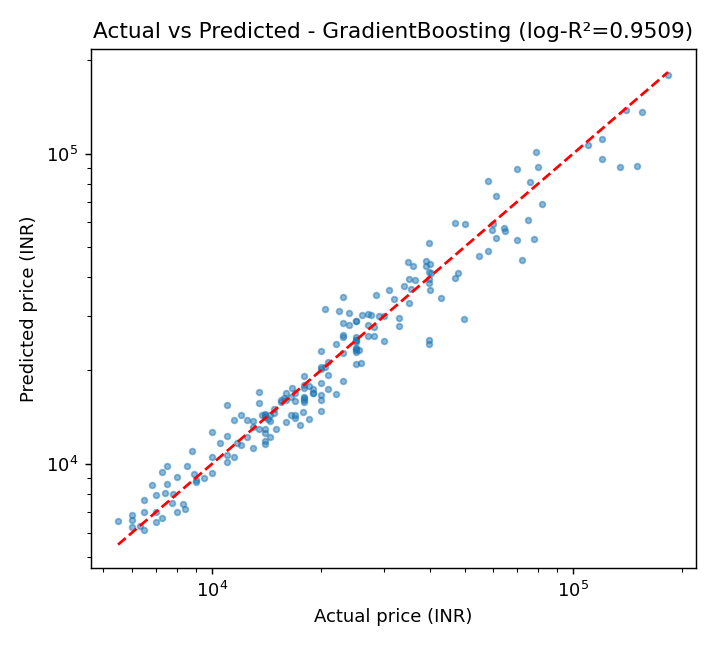
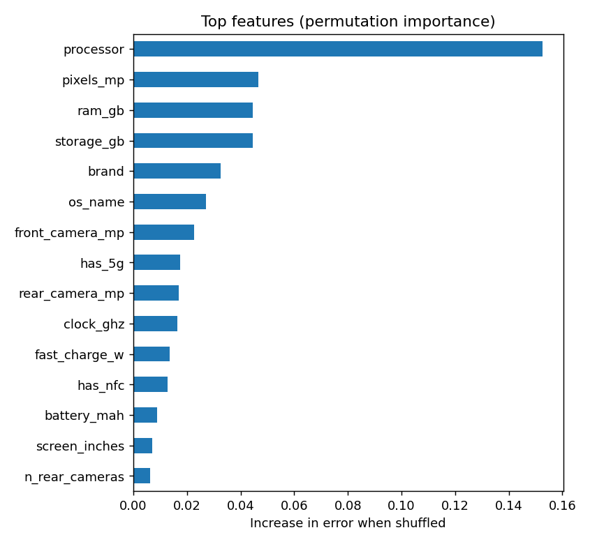

# 📱 Smartphone Price Predictor

End-to-end ML project on **real Indian smartphone data** (Smartprix-style scrape, ~1,000 phones): messy text parsing → feature engineering → model comparison → tuning → evaluation → interactive Streamlit app.

## Problem
Predict a smartphone's market price (₹) from its specifications and make the model usable through a web app.

## Data
`data/smartphones_raw.csv` — 1,020 listings with free-text columns such as `"12 GB RAM, 256 GB inbuilt"` or `"5000 mAh Battery with 100W Fast Charging"`.

**Cleaning (`data_cleaning.py`)**
- Regex-parsed text columns into 23 numeric/categorical features (RAM, storage incl. MB/TB, battery, charging watts, resolution, refresh rate, camera MP and count, 5G/NFC/IR, microSD, foldable, OS version, chipset cores/clock, ...).
- Fields are located by pattern, not column position, because foldables and feature phones have shifted cells.
- Fixed Indian-format prices (`₹1,06,990`), normalised brand names (`OPPO`/`Oppo`, `POCO`/`Poco`), removed duplicates and mis-scraped rows (placeholder prices, watches/accessories).
- Removed luxury/signature editions priced above ₹2,00,000 (e.g. Vertu): their price comes from the brand, not the specs.
- `rating` is **deliberately excluded**: it is derived from specs and price, so it would leak the target and isn't known for a new phone.

## Modelling (`train.py`)
| Step | Choice |
|---|---|
| Target | `log1p(price)`: prices span ₹3k – ₹2L and are right-skewed |
| Preprocessing | One `ColumnTransformer` pipeline: median impute + scale, one-hot (brand, OS, cut-out, variant), **target-encoded chipset** (~200 values, encoded inside CV, so no leakage) |
| Models | Median baseline, Ridge, Random Forest, Gradient Boosting, 5-fold CV |
| Selection metric | R² on log-price, so a few flagships don't dominate the score |
| Tuning | `GridSearchCV` on the best model |
| Final model | Refit on all data for the app; metrics below come from a held-out 20% test split |

## Results (held-out test set)
| Metric | Value |
|---|---|
| R² (₹ scale) | 0.918 |
| R² (log price) | 0.951 |
| MAE | ≈ ₹4,300 |
| Median absolute error | ≈ ₹1,950 |
| MAPE | 12.5% |
| Predictions within ±15% | 64% |

CV R² (log price): Baseline ≈ 0.00 · Ridge 0.892 · Random Forest 0.891 · **Gradient Boosting 0.904**




## Insights
- Chipset, RAM/storage, brand and variant (Pro/Ultra vs Lite) explain most of the price.
- Errors are largest on flagships and rare chipsets, where there are few training examples.
- Luxury outliers (a ₹6.5L Vertu, a ₹4.8L "Signature Edition") wrecked raw-scale R² on my first test split (≈0.17); excluding them and adding the model-variant feature brought it to 0.92. Outliers like these can't be predicted from specs.

## Run it
```bash
pip install -r requirements.txt
python train.py            # cleans data, trains, saves model + plots
streamlit run app.py
```

## Limitations & next steps
- ~1,000 samples and a single snapshot in time (no launch date, so no depreciation signal).
- Add SHAP explanations, LightGBM/XGBoost, and prediction intervals (quantile regression).
- Scrape fresh listings to grow the data; deploy on Streamlit Community Cloud.
